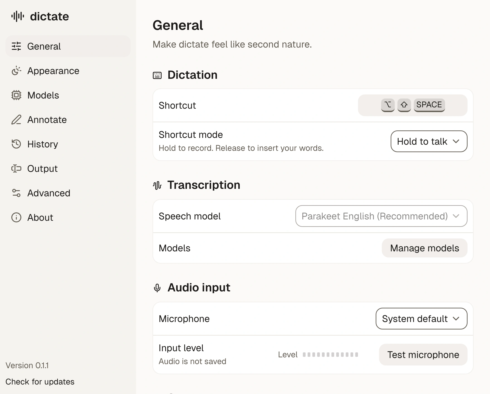
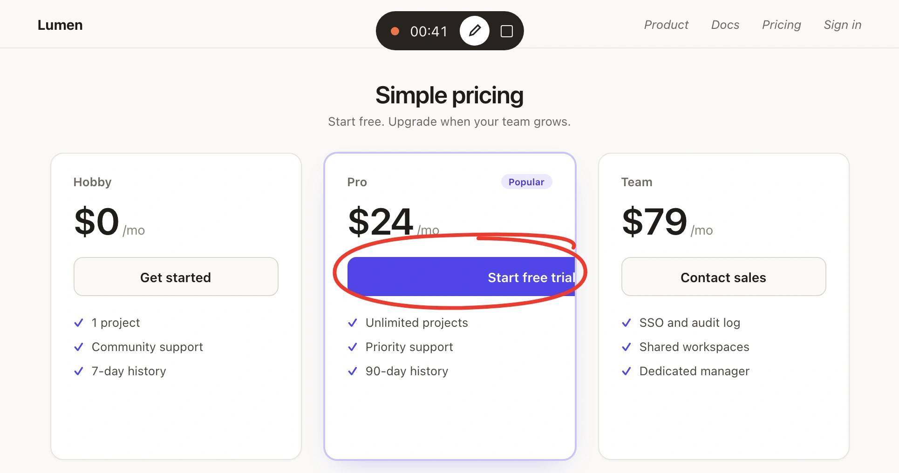

# dictate — Local-First Voice Dictation & Screen Annotation for macOS

Hold a key, speak, and the transcript lands in whatever app already has focus. Circle a UI glitch and talk with **Annotate** to package a screen recording, ink drawings, and a timed voice transcript into a structured summary you can paste straight into your coding agent. Everything runs 100% locally on Apple Silicon with Parakeet / Whisper on Metal and Silero VAD — zero cloud, zero telemetry, and no account.

Download the latest macOS build at **[dictate.kellycooks.dev](https://dictate.kellycooks.dev)**.

<picture>
  <source media="(prefers-color-scheme: dark)" srcset="docs/assets/settings-dark.png" />
  <source media="(prefers-color-scheme: light)" srcset="docs/assets/settings-light.png" />
  
</picture>



## Features

- 🎙️ **Hold-to-Talk & Toggle Dictation** — Hold `⌥⇧Space`, speak, and release to type directly into the focused app while preserving your clipboard, or switch to press-once toggle mode.
- ⚡ **Parakeet & Whisper on Apple Silicon Metal** — In-process `parakeet-tdt-0.6b-v2` inference via `transcribe-cpp` on ggml Metal (~80–235 ms release-to-text) alongside local Whisper models (`base.en`, `small.en`, `large-v3-turbo`).
- 🔇 **Silero VAD Room-Tone Filtering** — Pre-filters silence and background noise before inference so quiet holds and room tone never hallucinate stray words.
- 🖍️ **Annotate for Coding Agents** — Press `⌥⇧A` to record a display with ScreenCaptureKit, hold `Shift` to circle bugs in live ink, speak your diagnosis, and copy a timestamped Markdown + keyframe package ready for an AI agent.
- 🎨 **5 Astryx Themes with Independent Light & Dark Picks** — Choose separate light and dark themes across Ember, Paper, Capy, Rosé Pine, and Zinc, with a live-rendered theme-aware Dock and menu-bar icon.
- 🗂️ **Local History & Retention Controls** — Search past dictations and annotations, filter by source or date, inspect audio and keyframes, and configure automatic retention or bulk delete.
- 🔄 **Signed Automatic Updates** — Minisign-verified background update checks and one-click upgrades served from `dictate.kellycooks.dev`.

## Tech Stack ⚒️

- [Tauri v2](https://v2.tauri.app/) - macOS Desktop Shell & Native Panels (`tauri-nspanel`)
- [Rust](https://www.rust-lang.org/) - Audio Capture (`cpal`, `rubato`), ScreenCaptureKit & AppKit Pasteboard Pipeline
- [React 19](https://react.dev/) & [TypeScript](https://www.typescriptlang.org/) - Settings, History & Overlay UI
- [Astryx Design System](https://www.npmjs.com/package/@astryxdesign/core) & [StyleX](https://stylexjs.com/) - Component Library & Theme Tokens
- [transcribe-cpp](https://crates.io/crates/transcribe-cpp) / [Parakeet](https://huggingface.co/nvidia/parakeet-tdt-0.6b-v2) / [whisper.cpp](https://github.com/ggml-org/whisper.cpp) - Local Speech-to-Text on ggml Metal
- [Silero VAD](https://github.com/snakers4/silero-vad) - Voice Activity Detection
- [SQLite](https://www.sqlite.org/) (`rusqlite`) - Local History & Annotation Store
- [Astro](https://astro.build/) - Static Download & Update Site (`site/`)

## Install on macOS

Requires a Mac with **Apple Silicon** (M1 or later) running **macOS 15 (Sequoia)** or later.

1. **Download and install.** Download the latest `.dmg` from [dictate.kellycooks.dev](https://dictate.kellycooks.dev), open it, and drag **dictate** into **Applications**.
2. **First open (Gatekeeper bypass).** Because dictate is signed without a paid Apple Developer ID, macOS blocks the first launch. Try to open dictate once, then go to **System Settings › Privacy & Security**, scroll down to the notice for **dictate**, and click **Open Anyway**.
3. **Grant Microphone & Accessibility.** Allow **Microphone** access when prompted on your first recording, then enable dictate under **System Settings › Privacy & Security › Accessibility** so it can paste into the focused app. _(Grant **Screen Recording** as well if you use Annotate with `⌥⇧A`.)_
4. **Download a speech model.** Open dictate from the menu bar, go to **Models**, and download the recommended **Parakeet English** model (~661 MB).
5. **Dictate anywhere.** Click into any text field, hold `⌥⇧Space`, speak, and release.

## Run Locally

1. Clone the project

```bash
git clone https://github.com/KelechiOdom10/dictate.git
```

2. Go to the project directory

```bash
cd dictate
```

3. Install native build prerequisites (`transcribe-cpp` builds ggml Metal with CMake; optional Whisper CLI support uses `whisper-cpp`)

```bash
brew install cmake
```

4. Install dependencies

```bash
pnpm install
```

5. Useful Development Scripts:

```bash
# Start Tauri development window with Rust rebuild on save
pnpm tauri dev

# Typecheck and bundle the frontend
pnpm build

# Run Playwright UI end-to-end tests
pnpm test:ui

# Run Storybook component tests via Vitest
pnpm test:stories

# Run the Rust test suite
cargo test --manifest-path src-tauri/Cargo.toml

# Build a signed arm64 macOS release bundle and DMG
pnpm release:mac
```

## Architecture & Docs

The core dictation pipeline lives in `src-tauri/src/` as independently callable stages that convert audio once to 16 kHz mono `f32` at capture:

```text
audio (cpal + rubato 16 kHz mono f32) ──► vad (Silero VAD) ──► transcribe (Parakeet / Whisper on Metal) ──► insert (isolated pasteboard + restore)
```

Annotate (`src-tauri/src/annotate.rs`, `screen.rs`, `ink.rs`, `frames.rs`, `package.rs`) runs alongside the voice pipeline to record a display via ScreenCaptureKit, composite non-activating ink strokes, extract keyframes around speech segments, and write a structured Markdown bundle.

- [`docs/release.md`](docs/release.md) — Release build pipeline, code signing, DMG packaging, and Minisign auto-update publishing
- [`docs/spike-results.md`](docs/spike-results.md) — Hardware latency, capture, VAD, pasteboard restoration, and engine benchmarks measured on Apple Silicon
- [`docs/annotate-design.md`](docs/annotate-design.md) — Screen recording, ink overlay, and agent package format
- [`docs/stt-engines.md`](docs/stt-engines.md) — Parakeet and Whisper engine integration details

## Authors

- [@KelechiOdom10](https://github.com/KelechiOdom10)

## License

[MIT](LICENSE)

## Contributing

Contributions, bug reports, and ideas are welcome! Feel free to open an issue or submit a Pull Request. When touching a pipeline stage (`audio`, `vad`, `transcribe`, `insert`, or `annotate`), keep stages independently callable and include measurements from real hardware where latency or accuracy is affected.

## Acknowledgements

- [NVIDIA Parakeet](https://huggingface.co/nvidia/parakeet-tdt-0.6b-v2) and [transcribe-cpp](https://crates.io/crates/transcribe-cpp) for fast local English speech recognition on Metal
- [whisper.cpp](https://github.com/ggml-org/whisper.cpp) and [ggml](https://github.com/ggml-org/ggml) for on-device Whisper inference
- [Silero VAD](https://github.com/snakers4/silero-vad) for lightweight voice activity detection
- [Tauri](https://v2.tauri.app/) for the macOS application runtime
- [Astryx](https://www.npmjs.com/package/@astryxdesign/core) for the component system and multi-theme engine
