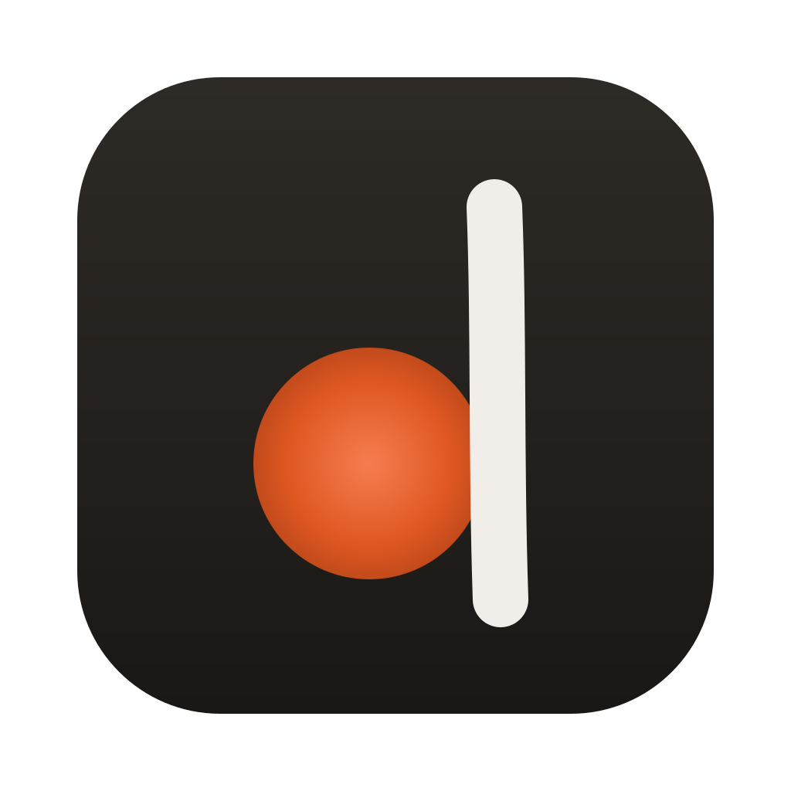

# Giving dictate to a second Mac

The question: what it takes to give dictate to a non-developer on another Mac,
so she can install it, grant its permissions once, and keep using it through
updates. Researched on 15 Nov 2026 against `fix/qa-round-2-polish` at
`e8deeb7`, on this machine (macOS 27.0.1, Apple Silicon, Command Line Tools
only, no Xcode, no signing identities in the keychain). The first-run and
signing sections were re-checked on 16 Nov against the current `main`,
`39721e6`, after the QA and Parakeet rounds changed the defaults.

Each claim is marked **verified** (ran here, output quoted) or **inferred**
(from docs or reasoning, not run here). Nothing here is a release claim: the
documented build, signing and updater steps have not been shipped, and the one
end-to-end permission check is an acceptance step in §6.3, not a result.

## Answer

1. `pnpm tauri build` **fails today**. One config line fixes it: set
   `bundle.macOS.minimumSystemVersion` to `"15.0"`. With that, it builds a
   17 MB Apple Silicon `.app` and a 6.8 MB DMG.
2. Her permissions are the deciding factor, more than Gatekeeper. The default
   build is ad-hoc signed, and an ad-hoc signature's designated requirement —
   the thing macOS matches a permission grant against — is that build's own
   code hash, so a new build is a different app to macOS's privacy database.
   The expected consequence is that **every update makes her grant Microphone
   and Accessibility again**. Apple's guidance is exactly this: sign with a
   stable identity, not ad hoc. But **the end-to-end effect was not measured
   here** — no build was installed over a running one with live grants — so
   "she is asked again" is a documented mechanism, not an observation. The two
   signings meant to avoid it are a self-signed certificate (free, but she has
   to use "Open Anyway" once per install) and a Developer ID with notarization
   ($99 a year, no warnings). For both, what was verified is the property a
   grant is matched against, and only that: the designated requirement is
   identical across two builds with different contents (§2). Whether a real
   grant then survives an install is the manual check in §6.3.
3. For delivery, the recommendation is a DMG now and the Tauri updater later,
   hosted somewhere public, because a private GitHub repo can't serve updates
   without putting a token in the app.
4. On her first run she meets three problems in a row: there is no model, no
   permission is requested until it is needed, and Accessibility is never
   requested at all. A first-run setup window is the biggest gap.

## 1. Build

| Run | Result |
|---|---|
| `pnpm tauri build --bundles app` (as checked in) | **Fails, verified.** Tauri passes `-mmacosx-version-min=10.13` (its default minimum) to the CMake build of `transcribe-cpp-sys`. ggml uses `std::filesystem`, which is unavailable before 10.15: `error: 'path' is unavailable: introduced in macOS 10.15`. Dev builds work because no deployment target is set there. |
| same, `minimumSystemVersion: "14.0"` | **Fails, verified**, at link time: `Undefined symbols: ___isPlatformVersionAtLeast` from `ggml-metal-device.m.o`. ggml's Metal code has `@available(macOS 15.0, *)` checks. Below 15 those become runtime calls into clang's runtime library, which the Rust link step doesn't include. |
| same, `minimumSystemVersion: "15.0"` | **Builds, verified.** 3 min 37 s cold. `dictate.app` is **17.34 MiB**: an 18 MB arm64 binary with Parakeet/ggml and the Metal shaders linked in statically, plus the icon. No sidecar binaries. |
| `--bundles dmg`, `CI=true`, `signingIdentity: "-"` | **Builds, verified.** `dictate_0.1.0_aarch64.dmg` is **6.79 MiB**. `CI=true` skips the Finder AppleScript that lays out the window, so it never waits on an Automation prompt. |

Gotcha, verified: CMake caches the first deployment target it sees
(`CMAKE_OSX_DEPLOYMENT_TARGET:STRING=10.13` in `CMakeCache.txt`). After changing
`minimumSystemVersion`, delete `target/release/build/transcribe-cpp-sys-*`, or
the old value wins.

Facts about the bundle (verified with `plutil`, `lipo` and `otool`):

- `CFBundleIdentifier` is `com.kelechiodom.dictate`. Nothing in this plan changes it.
- `NSMicrophoneUsageDescription` is present. `LSMinimumSystemVersion` is `15.0`.
- The binary is `arm64` only. Its only dynamic libraries outside the system
  frameworks are the Swift runtime in `/usr/lib/swift`, which ships with
  macOS 12 and later.
- Model weights are **not** in the bundle. Parakeet (731 MB) downloads to
  `~/Library/Application Support/com.kelechiodom.dictate/models/`.
- Parakeet is the default and runs in process. whisper-cli is only needed for
  the Whisper models, so she never needs Homebrew.

The **macOS 15 minimum** is also what Annotate already requires:
`screen.rs:328` says "Annotate needs macOS 15 or later". If her Mac is on
macOS 14, the only route is linking `libclang_rt.osx.a` in `build.rs`. Inferred,
not tried.

**Apple Silicon only, or universal.** Only `aarch64-apple-darwin` is installed
here, so universal wasn't tried. A universal build needs
`rustup target add x86_64-apple-darwin` and
`tauri build --target universal-apple-darwin`. Inferred: it roughly doubles the
binary to about 35 MB, and Parakeet on an Intel Mac's GPU would be much slower
than the numbers in `spike-results.md`. **Build Apple Silicon only unless her
Mac is Intel.**

## 2. Signing, and what each option means for her

The key fact: macOS's privacy database (TCC) records a grant together with the
app's **designated requirement** (DR), and checks every later access against
it. Apple DTS says to sign with "a stable signing identity, that is, not
unsigned and not ad hoc signed" for exactly this reason ([TN3127][tn3127],
[DTS on TCC][dts-tcc]).

The DR of each signing option, from `codesign -d -r-` on the real build
(verified):

| Signing | Designated requirement | Same across rebuilds? |
|---|---|---|
| As built today (linker ad-hoc) | `cdhash H"a1cd951a…"`. Identifier `dictate-e4efeafde9e915e3`, Info.plist not bound | No |
| Ad-hoc bundle signing (`signingIdentity: "-"`) | `cdhash H"3fc4043a…"`. Identifier `com.kelechiodom.dictate` | No |
| Self-signed certificate, two different builds | `identifier "com.kelechiodom.dictate" and certificate leaf = H"561d706a…"`, **identical for both** | **Yes** |
| Developer ID (from Apple's docs) | `anchor apple generic and identifier "com.kelechiodom.dictate" and … certificate leaf[subject.OU] = <TEAMID>` | **Yes**, while the Team ID stays the same |

The self-signed row was tested with a throwaway certificate in a temporary
keychain, deleted afterwards. The test signed two builds with different
contents and both gave the same DR. That is the whole experiment: it shows the
DR does not move between builds, and nothing about what macOS does with a grant
when a new build appears. The manual check in §6.3 is what closes that gap.

What each option means for her:

**(a) Developer ID + notarization ($99 a year).** Double-click, then a single
"downloaded from the internet" confirmation. The DR names the certificate and
the Team ID, so it should not change between builds, and permissions should
survive every update — expected, not observed here.
Notarization requires the hardened runtime, and under the hardened runtime the
microphone needs the `com.apple.security.device.audio-input` entitlement, or
access is silently denied ([Apple][audio-ent]). That means adding an
`Entitlements.plist` and `bundle.macOS.entitlements`. Tauri signs and notarizes
during `tauri build` when `APPLE_SIGNING_IDENTITY` and the `APPLE_API_KEY*` or
`APPLE_ID`/`APPLE_PASSWORD`/`APPLE_TEAM_ID` variables are set ([Tauri][tauri-sign]).
The build log confirms it: "skipping app notarization, no APPLE_ID…".
`notarytool` and `stapler` are already installed with the Command Line Tools
(verified). No Xcode is needed.

**(b) Ad-hoc.** Gatekeeper blocks the first launch, and `spctl` returned
`rejected` (verified). **Right-click › Open no longer works.** Since macOS 15
she has to try to open the app, then go to System Settings › Privacy &
Security and click **Open Anyway** within about an hour ([Apple developer
news][sequoia]). Worse, **each update is a fresh app to the privacy database**,
because the DR is the build's hash, so Microphone and Accessibility are
expected to be requested again. Any old "dictate" entry stays in the
Accessibility list, switched on but matching nothing — the "I turned it on and
it still says not allowed" confusion. Not acceptable for someone who should
just use it, and the §6.3 manual check should confirm it before anyone quotes
it as fact.

**(c) Self-signed certificate (free, a middle ground).** Kelechi creates one
"dictate local signing" code-signing certificate once, keeps it in his
keychain, and signs every release with it (`bundle.macOS.signingIdentity`).
Gatekeeper still blocks each new download, so she needs Open Anyway once per
install. The quarantine flag comes from the browser or AirDrop. Permissions are
expected to persist because the DR names the certificate rather than the build,
and that DR was verified stable across two builds above — the unproven step is
what §6.3 checks. If the certificate is lost, she re-grants once.

**Recommendation:** use (c) now if Kelechi doesn't want to pay yet. Move to (a)
before updates are routine. Switching from (c) to (a) changes the DR, so she
re-grants once at that switch (inferred from [TN3127][tn3127]).

## 3. Delivery and updates

| Option | Her experience | Cost to us |
|---|---|---|
| **DMG** (verified, 6.8 MB) | Open, drag to Applications. The familiar Mac install. | Already built by `tauri build`. |
| zip of `.app` | Unzip, move to Applications herself. Easy to run it from Downloads by mistake, where App Translocation runs it from a random path (inferred). | None. |
| Manual reinstall | Download each new DMG and replace the app. With (a) or (c), permissions should survive; §6.3 is the check. | Send her a link each time. |
| **Tauri updater** | "Update available", click, relaunch. | `tauri-plugin-updater` + `-process`, a minisign key pair (`tauri signer generate`; the private key and password stay with Kelechi), `bundle.createUpdaterArtifacts: true` (adds `dictate.app.tar.gz` + `.sig`), and a `latest.json` manifest at a fixed URL ([Tauri updater][tauri-updater]). |

**Can she fetch updates from the private repo? No, not without a token.**
`KelechiOdom10/dictate` is `PRIVATE` (verified with `gh repo view`). Private
release assets return 404 without auth, and `releases/latest/download/...`
ignores an `Authorization` header ([report][private-gh]). The workarounds put a
token inside the app, where anyone with the app can extract it, or need a proxy
server. Simplest: **a separate public repo, `dictate-releases`, holding only
release assets and `latest.json`**. The source stays private, and updater
artifacts are signed, so a public host can't push a tampered build. Any static
host (R2, Pages) works the same way.

The updater signature is separate from Apple signing. It protects the download
and doesn't help with Gatekeeper or TCC. With ad-hoc signing, the updater would
still turn every release into a new app for the privacy database. **Adopt the
updater only together with (a) or (c).**

## 4. Her first run, today

What she sees, traced through `lib.rs` setup and the pipeline (inferred from
code; the packaged app was not launched here, to avoid clashing with the dev
instance's global shortcuts):

1. Gatekeeper, as in §2.
2. The Settings window opens (`lib.rs:2024`, anything but `--autostart`).
   **No model is installed.** Parakeet is the default (`settings.rs:151`) and
   nothing downloads it, so she has to find Models and start a **731 MB**
   download.
3. She holds ⌥⇧Space without knowing that is the shortcut. It is the default
   (`settings.rs:132`) and General shows it in a recorder (`GeneralSettings.tsx:119`),
   but nothing tells her to look. The **Microphone** prompt appears only when
   cpal first opens the device, in the middle of her first take, so that take is
   lost or empty (inferred).
4. If the model isn't there yet, she gets "Speech model missing — Download a
   speech model in Settings › Models" (`transcribe.rs:687`).
5. On a finished transcript the paste path splits three ways
   (`insert.rs:95`-`106`). If Output is set to **Copy only**, or no editable
   text field has focus, the transcript is put on the clipboard and the overlay
   says "Copied — paste it anywhere" (`RecordingCapsule.tsx:72`) — no
   permission is needed for that, and nothing is lost. Otherwise it asks
   `AXIsProcessTrusted()` (`insert.rs:102`), which **only checks and never
   prompts**, so without the permission she gets "Accessibility access needed"
   and has to find the pane by hand; in a signed build dictate does appear
   there. The terminal-app hint is dev-only (`AnnotatePage.tsx:133`). The
   defaults are paste with the previous clipboard restored
   (`settings.rs:153`-`154`), no trailing space and no capitalisation
   (`settings.rs:155`-`156`), so the first-run text arrives exactly as spoken.
6. **Screen Recording** matters only for Annotate, and only when she uses it.
   Annotate is **on by default** (`settings.rs:160`) and registers **⌥⇧A**
   (`settings.rs:136`) globally. For a dictation-only user that is a shortcut
   she didn't ask for, and the first Annotate attempt is where the Screen
   Recording prompt appears.

The right order, and why:

1. **Model download** first. It is the slowest step, so start it before the
   permissions so it runs while she reads.
2. **Microphone**: an "Allow microphone" button that opens the device once
   (or uses `AVCaptureDevice requestAccess`), so the prompt has context.
3. **Accessibility**: `AXIsProcessTrustedWithOptions` with
   `kAXTrustedCheckOptionPrompt`, plus a button to the pane. Poll until it is
   trusted (a grant takes effect without a relaunch; inferred).
4. **Try it**: hold ⌥⇧Space and say something into a text box on the page, so
   the paste path is exercised rather than the copy fallback.
5. Screen Recording **only** when she turns Annotate on. Keep Annotate off by
   default for a fresh install, and say what its shortcut is when it is on.

Other gaps:

- **No real icon.** `src-tauri/icons/` holds Tauri's template icons.
- **The menu-bar icon is drawn at 22×22 at 1×** (`surface.rs:96`). It is a
  template, which is correct, but it has no 44×44 @2x version, so it is likely
  soft on Retina (inferred).
- The Settings sidebar logo is lucide's `AudioLines` (`SettingsWindow.tsx:87`).
- "Check for updates" is a disabled placeholder (`SettingsWindow.tsx:114`).
- `version` is `0.1.0` in both `tauri.conf.json` and `Cargo.toml`. The updater
  needs a version bump per release. `Cargo.toml` still says `description = "A
  Tauri App"` and `authors = ["you"]`.
- Launch at login is off by default. For a dictation utility, offer it in setup.

## 5. Icon

Three drafts in [`icon-drafts/`](icon-drafts/), built on the macOS 1024 grid
(an 824 px rounded square inset 100 px, about 185 px corners) using Ember/Paper
tokens from `src/ui/palettes.generated.json`: paper `#FBFAF8`, ink `#1C1A18`,
ember `#DF5822`, muted `#635D54`.

| | Draft | Idea |
|---|---|---|
| A |  | **Ember wave.** Five rounded ink bars on paper, with the middle one in ember, the recording colour. It continues the existing tray glyph and sidebar mark, so menu bar, Dock and Settings read as one family. Safest. |
| B |  | **Speech to caret.** A hand-drawn ink speech bubble whose last line ends in an ember text caret: speech in, text out. Says what the app does; busier at 16 px. |
| C |  | **Ember d.** A lowercase d on warm charcoal. The bowl is the ember record dot and the stem a slightly uneven pen stroke. The most distinctive, and the one that most needs a designer's pass. |

Recommendation: **A**. It is the only one that also works as the menu-bar glyph
([`tray-template.svg`](icon-drafts/tray-template.svg)), and it still reads at
16 px.

What macOS needs:

- **`.icns`** containing 16, 32, 128, 256 and 512 pt at @1x and @2x (16 to
  1024 px). `pnpm tauri icon docs/icon-drafts/a-ember-wave.svg` (or a 1024 px
  PNG of it) regenerates `src-tauri/icons/` (`icon.icns`, `32x32.png`,
  `128x128.png`, `128x128@2x.png`, …), which `tauri.conf.json` already points
  at. The Windows and Square*Logo files it also writes are harmless.
- **The menu-bar template**: black plus alpha only, about 18 pt of glyph in a
  22 pt box, shipped at 22 px **and 44 px**, set with `icon_as_template(true)`
  (already set). Either rasterise the SVG into `icons/tray.png` and
  `tray@2x.png` and load them, or keep drawing in `surface.rs` at 44 px with
  the rounded caps from the SVG.
- macOS 26 shows icons in a uniform rounded square and can tint them. Apple's
  new layered format comes from Icon Composer, which needs Xcode (inferred; not
  installed here). The flat `.icns` above still works. Adopting Icon Composer
  is a later polish step.

## 6. Build plan

Four PRs, in order. The first two give her a usable install; the last two make
it stay that way.

**1. Releasable build + icon.**
Set `bundle.macOS.minimumSystemVersion: "15.0"`. Add `Entitlements.plist` with
`com.apple.security.device.audio-input` and point `bundle.macOS.entitlements`
at it. Regenerate the icons from the chosen draft. Draw the tray icon at @2x.
Replace the `AudioLines` sidebar mark. Fix the `Cargo.toml` description and
authors. Add a `pnpm release:mac` script that runs
`CI=true tauri build --bundles app,dmg` and documents the CMake-cache gotcha.

*Accept:* `pnpm release:mac` exits 0 from a clean
`target/release/build/transcribe-cpp-sys-*`. `plutil` shows
`com.kelechiodom.dictate` and `LSMinimumSystemVersion 15.0`. `codesign -d
--entitlements -` shows audio-input. The DMG mounts with the new icon in
Finder, the Dock and the menu bar (screenshot at 2×).

**2. First-run setup.**
A setup page shown when no model is installed or a permission is missing:
download Parakeet (with progress), then the microphone, then Accessibility
(`AXIsProcessTrustedWithOptions` prompt and polling), then a try-it box.
Annotate off by default for new settings files. Existing users keep their
saved value. Offer launch at login.

*Accept:* with a fresh `~/Library/Application Support/com.kelechiodom.dictate`
and `tccutil reset Microphone com.kelechiodom.dictate` plus
`tccutil reset Accessibility com.kelechiodom.dictate`, a signed build walks
through all steps and the first dictation pastes. Unit tests for the step-state
logic. Screenshots of each step in Ember and Paper.

**3. Stable signing.**
Use whichever identity Kelechi picks: self-signed (with a one-command script to
create it) or Developer ID with notarization through `notarytool` and an App
Store Connect API key. `signingIdentity` comes from an environment variable,
never committed.

*Accept:* `codesign -d -r-` shows a non-cdhash DR. Two consecutive builds have
an identical DR. With Developer ID: `spctl -a -vv` says `accepted, source=Notarized
Developer ID` and `stapler validate` passes. Manual check: grant Mic and
Accessibility, install the next build over it, and dictation still pastes with
no prompt.

**4. Updates.**
`tauri-plugin-updater` + `tauri-plugin-process`. A minisign public key in
config. Endpoint `latest.json` on the public `dictate-releases` repo. Wire up
"Check for updates", plus a quiet check on launch. A script or GitHub Action
that builds, signs and uploads the DMG, `.app.tar.gz`, `.sig` and `latest.json`.

*Accept:* version 0.1.1 installed, version 0.1.2 published, and the app offers,
downloads, verifies and relaunches into 0.1.2 with permissions intact. A
tampered `.tar.gz` is rejected.

## Decisions only Kelechi can make

1. **Pay for a Developer ID ($99 a year)**, or start self-signed. Self-signed
   is fine for one person. Developer ID matters once updates are frequent or
   more people use it.
2. **Her Mac: Apple Silicon or Intel, and which macOS?** That decides
   arm64 versus universal, and whether macOS 15 is a safe minimum.
3. **Where releases live**: a public `dictate-releases` repo (recommended), a
   static bucket, or manual DMGs over AirDrop.
4. **Which icon direction**, A, B or C, or a brief to a designer.
5. **Whether Annotate ships to her at all**, or stays off and hidden for
   non-developer installs.

[tn3127]: https://developer.apple.com/documentation/technotes/tn3127-inside-code-signing-requirements
[dts-tcc]: https://developer.apple.com/forums/thread/730043
[audio-ent]: https://developer.apple.com/documentation/bundleresources/entitlements/com.apple.security.device.audio-input
[sequoia]: https://developer.apple.com/news/?id=saqachfa
[tauri-sign]: https://v2.tauri.app/distribute/sign/macos/
[tauri-updater]: https://v2.tauri.app/plugin/updater/
[private-gh]: https://github.com/j4rviscmd/tauri-updater-private
