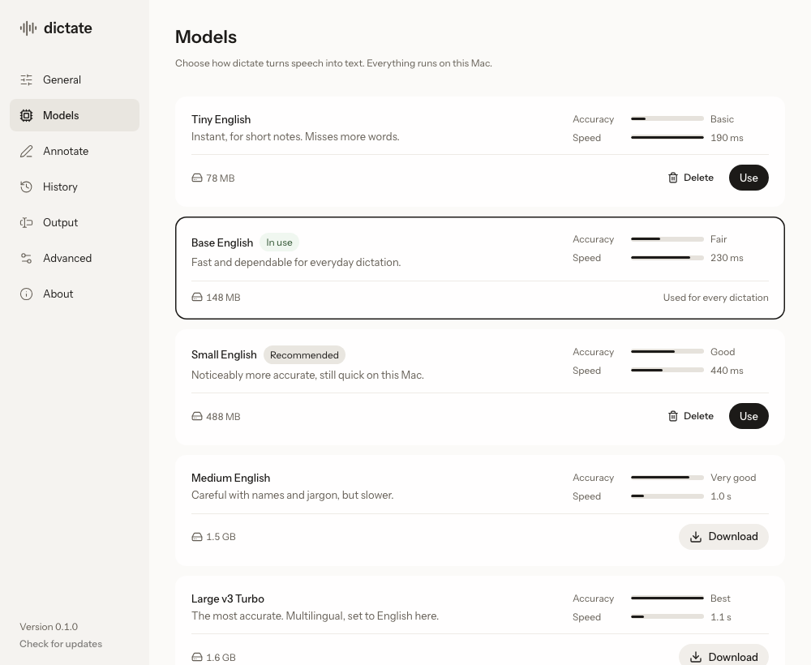
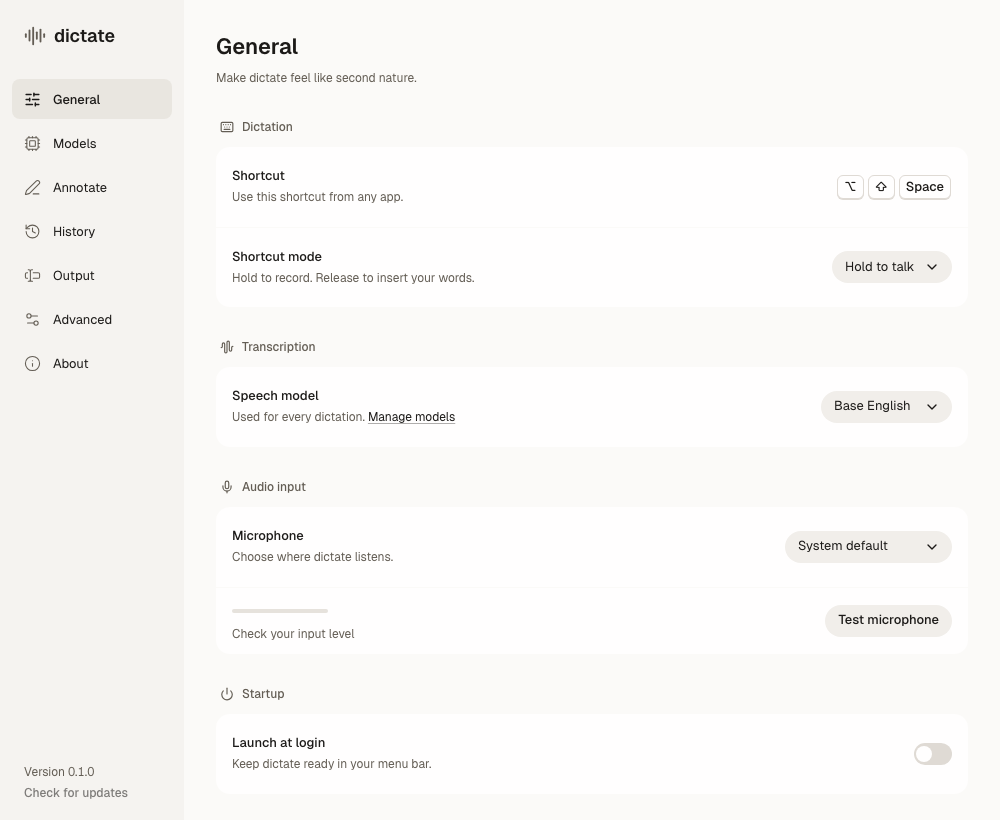
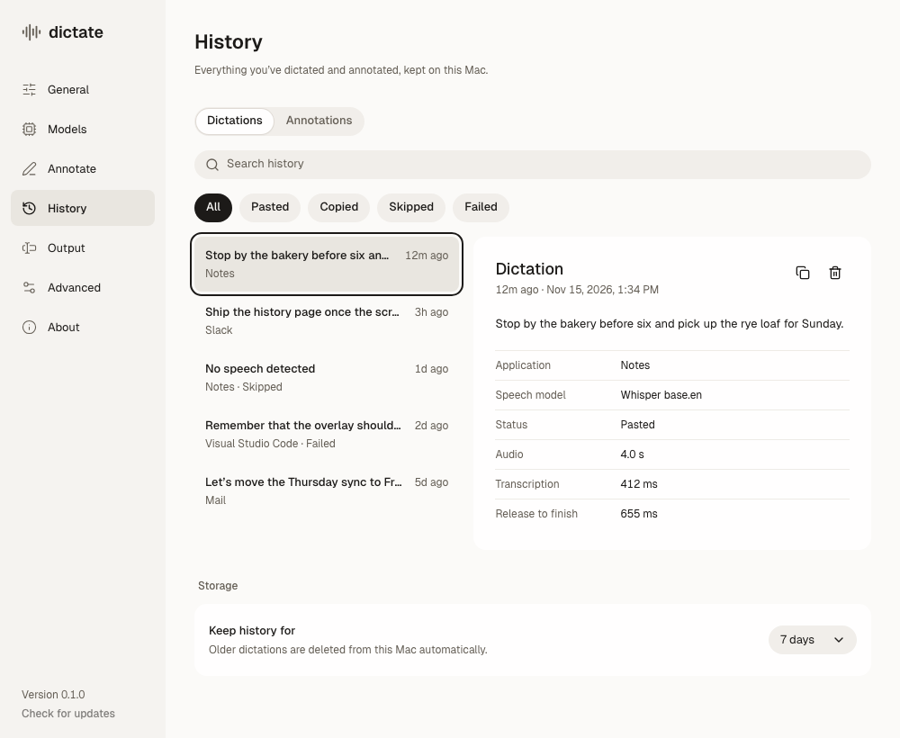
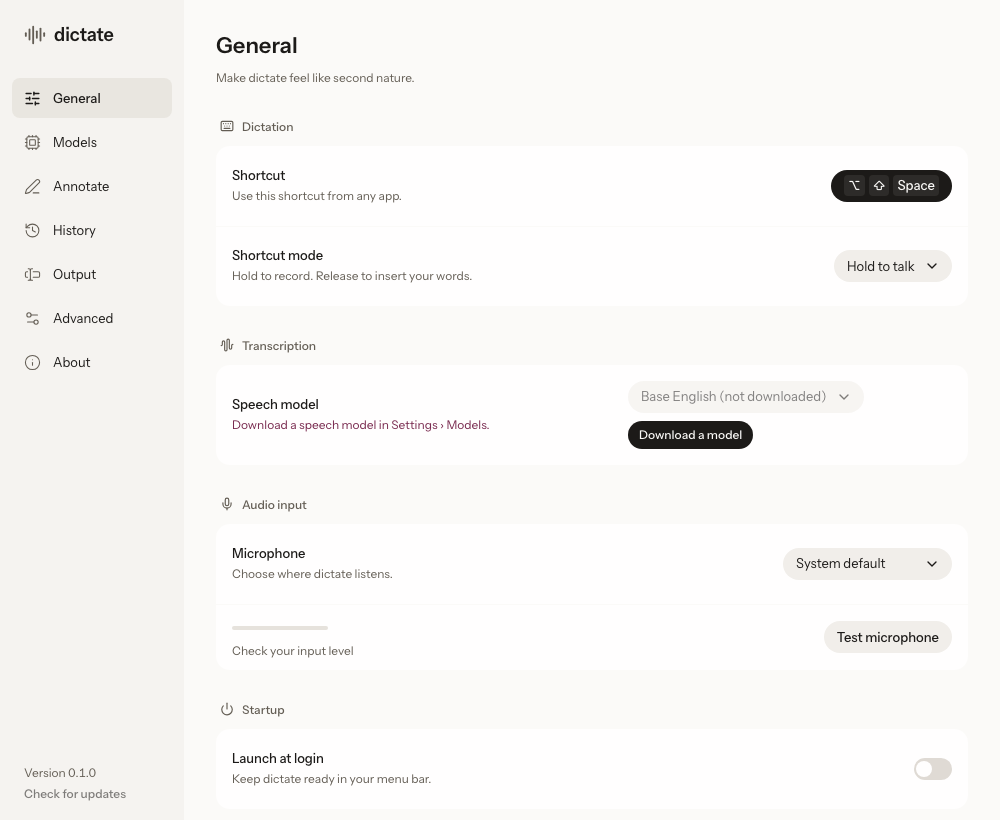
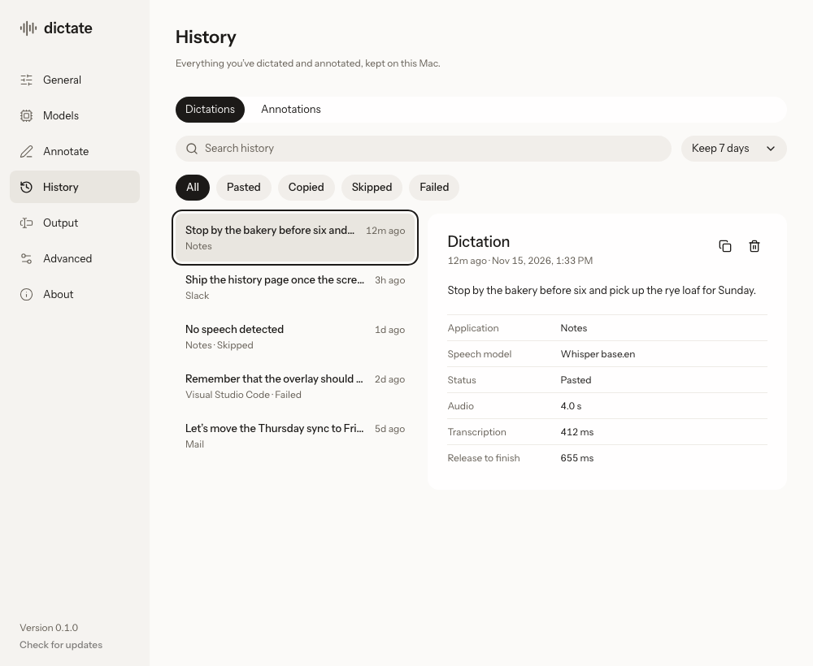
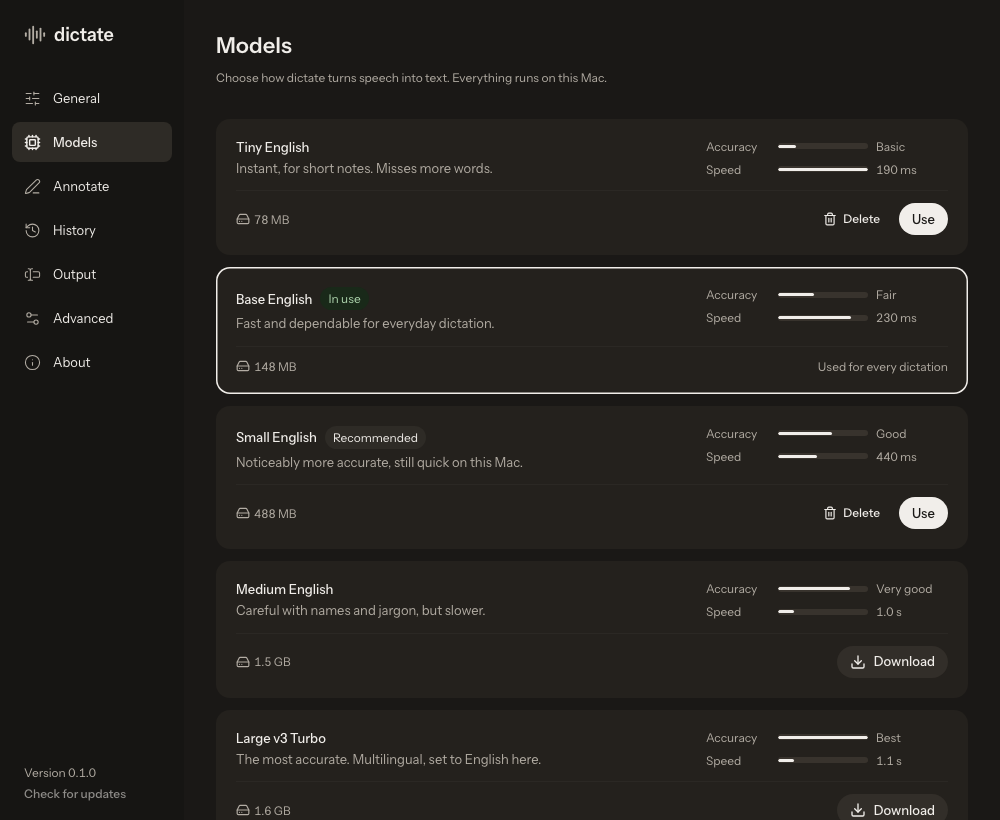
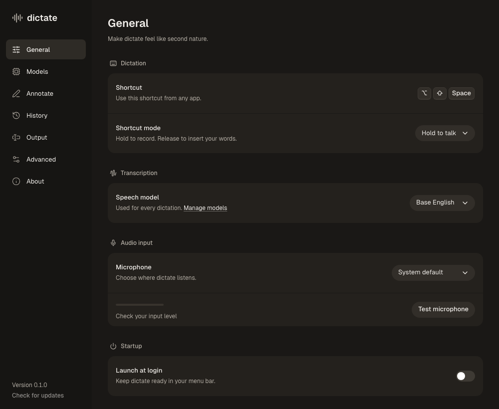

# QA round 1

The screenshots use isolated Storybook fixtures, not the owner's transcripts.
Before: 775b4fe (#32). Models-only: 296aade. After: c561476.
Each view is captured in Ember/Paper and light/dark.

To keep borders only on model cards, drop commit fd44b21 (or revert it).
Geist is bundled locally with its OFL license.

## Walkthrough

The native menu reads installed model files and the saved model choice. Choosing
a model uses the same validated settings save as the Models page; changes and
downloads rebuild the menu. Paste and Copy read the latest nonempty transcript
from retained History. With History disabled or empty they show an error.
Settings and Quit use native Command-comma and Command-Q accelerators.
Update checking is a stub that opens Settings with a notice.

Turning Annotate on now requests Screen Recording access if preflight is false.
The settings button already requested access before opening the pane. Both use
ScreenCaptureAccess.request, which calls CGRequestScreenCaptureAccess; status
uses ScreenCaptureAccess.preflight, which calls CGPreflightScreenCaptureAccess.
Tauri's development mode selects terminal-specific permission guidance.

## Validation

- cargo fmt: passed.
- cargo clippy -- -D warnings: passed.
- cargo test: 168 unit tests and 3 integration tests passed; 10 hardware/manual tests ignored.
- pnpm build: passed.
- pnpm test:stories: 348 passed across four theme combinations.
- pnpm test:ui: 17 passed.
- pnpm format:check: passed.
- Spacing story first failed against the changed shortcut/segments, then passed
  after updating its assertions for the intended compact controls.
- Screenshots inspected: General's right-aligned download and quiet keycaps,
  History's compact tabs and separate retention, and light/dark model cards.
- Full six-domain interface review and native interaction proof remain incomplete.

## Manual checks for Kelechi

No synthetic desktop input was used. Native menu screenshots are still missing.

1. Run the app, click its menu bar icon, and capture the open menu in macOS
   light and dark appearances. Repeat with Ember/Paper selected. Expand Speech
   Model, choose an installed model, reopen it and check its tick and Settings.
2. Dictate a sentence with History enabled. With a disposable document focused,
   open the menu and choose Paste Last Dictation. Confirm text lands in that
   document and the previous clipboard contents return. Choose Copy Last
   Transcript and paste manually to verify it. No automatic desktop driver runs.
3. Use Settings… and Quit dictate, including Command-comma and Command-Q.
   Check for Updates… should show the coming-later notice.
4. In a bundled app without Screen Recording permission, turn Annotate on.
   Confirm macOS asks and lists dictate. Grant access, restart, and confirm the
   status says Allowed. Repeat via Open System Settings when access is denied.
5. In a dev run, confirm denied-access help names the parent terminal. Enable
   that terminal in Screen Recording and restart. Do not reset existing TCC grants
   just to test this branch.
6. Compare the three sets below. Choose whether to keep the optional all-card
   borders before merging.

## Screenshots

### Ember · light

**general-no-model**

| Before | After |
| --- | --- |
|  |  |

**models-installed**

| Before | After |
| --- | --- |
|  |  |

**history**

| Before | After |
| --- | --- |
|  |  |

Models-only borders, before the optional all-card commit:

### Ember · dark

**general-no-model**

| Before | After |
| --- | --- |
|  |  |

**models-installed**

| Before | After |
| --- | --- |
|  |  |

**history**

| Before | After |
| --- | --- |
|  |  |

Models-only borders, before the optional all-card commit:

### Paper · light

**general-no-model**

| Before | After |
| --- | --- |
|  |  |

**models-installed**

| Before | After |
| --- | --- |
|  |  |

**history**

| Before | After |
| --- | --- |
|  |  |

Models-only borders, before the optional all-card commit:

### Paper · dark

**general-no-model**

| Before | After |
| --- | --- |
|  |  |

**models-installed**

| Before | After |
| --- | --- |
|  |  |

**history**

| Before | After |
| --- | --- |
|  |  |

Models-only borders, before the optional all-card commit:

