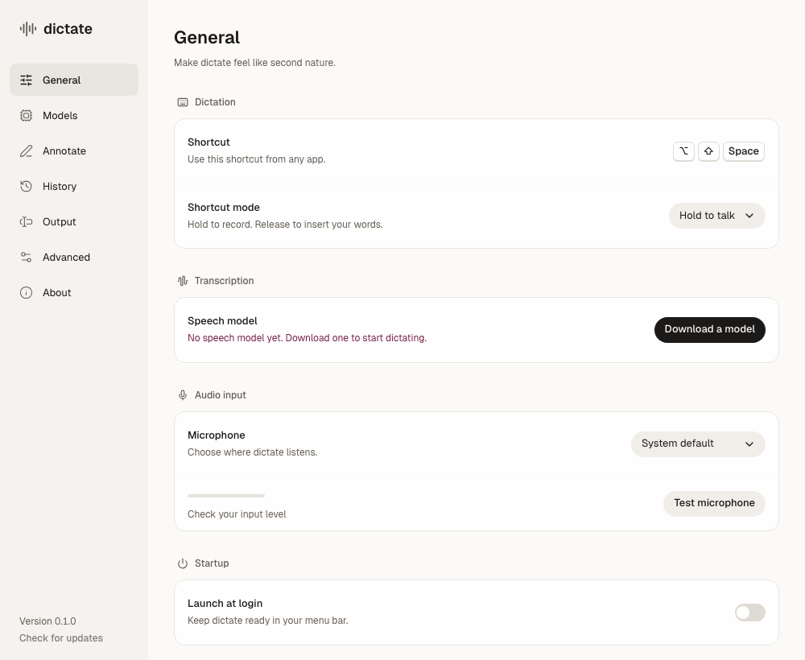
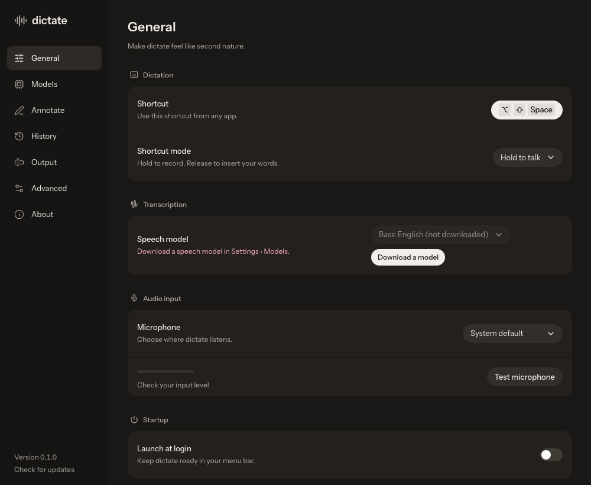
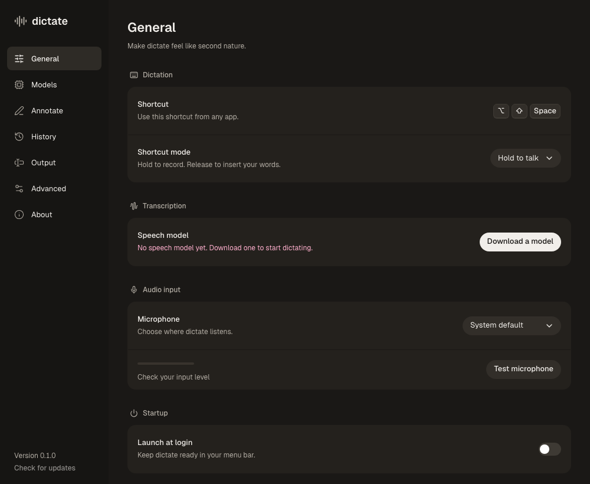
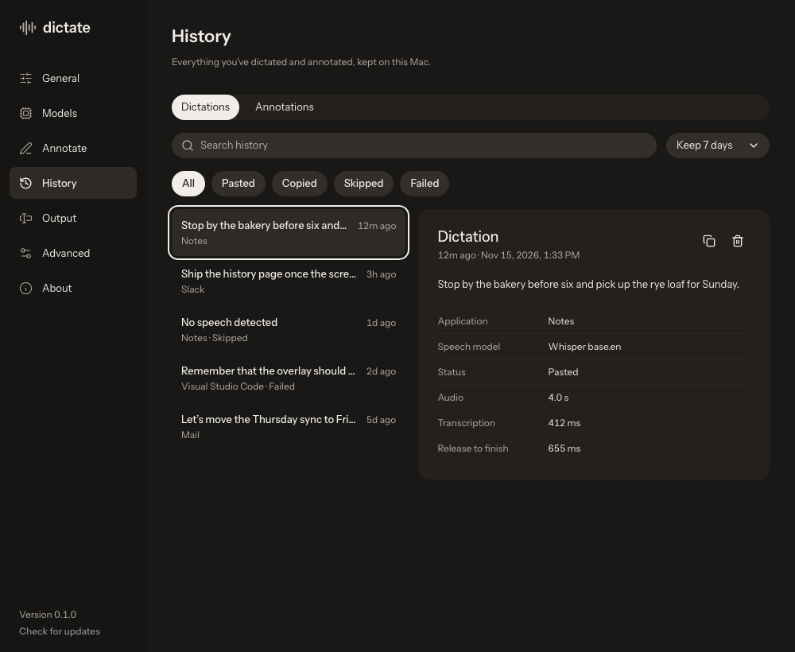
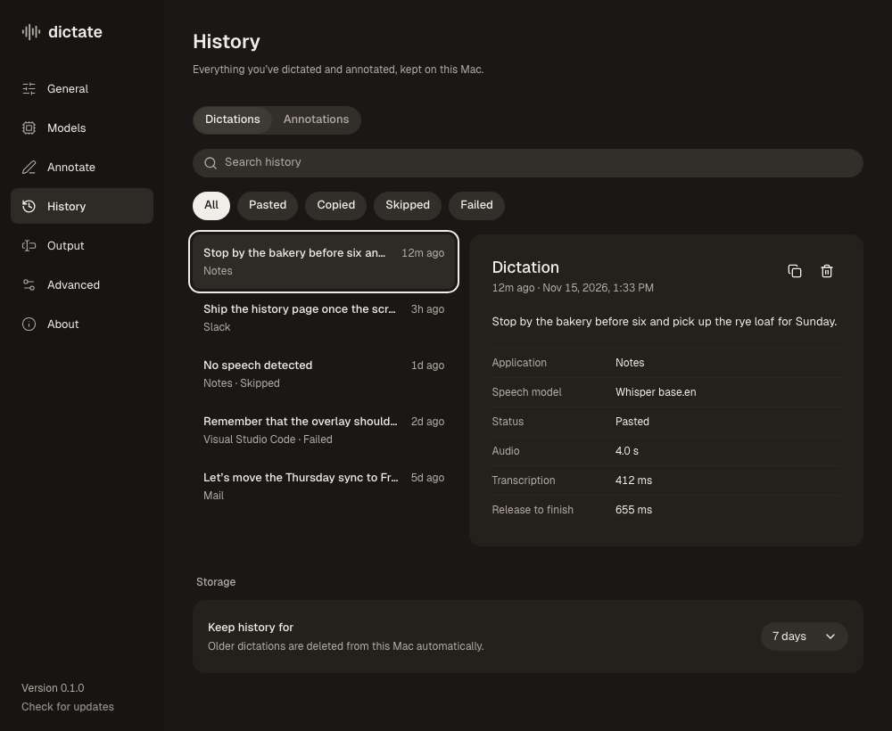
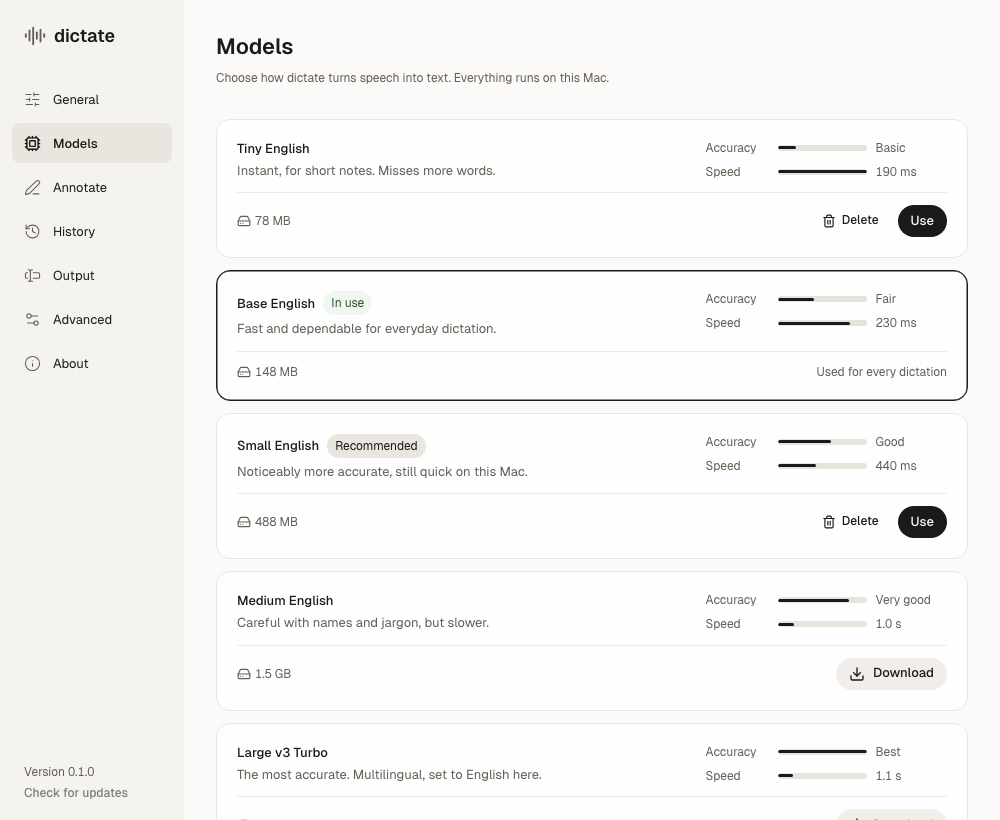
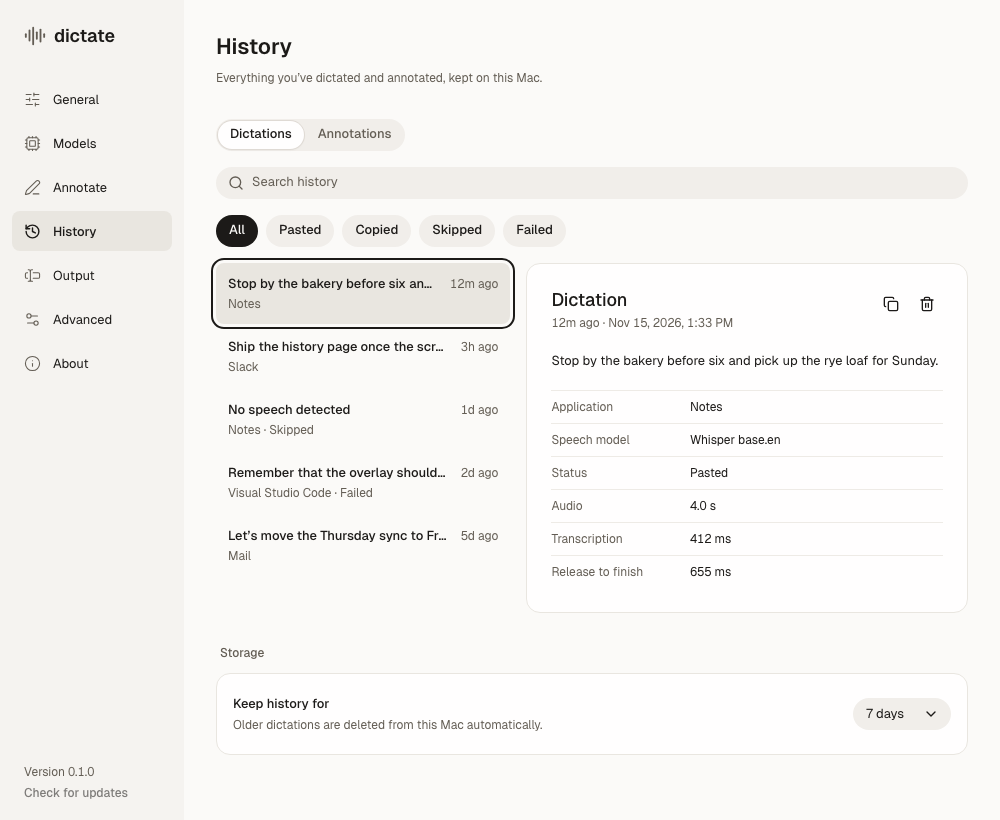
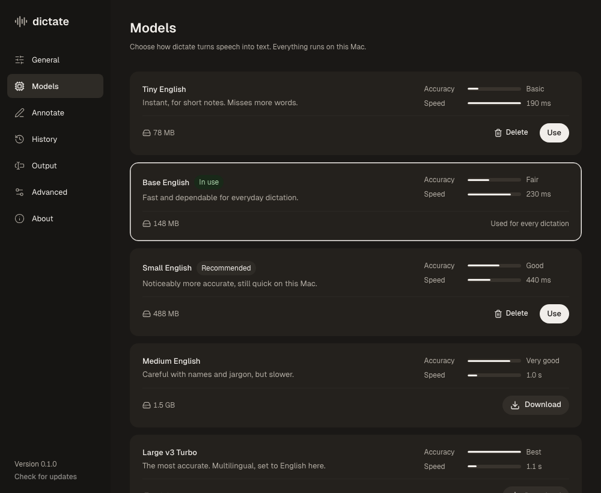

# QA round 1

The screenshots use isolated Storybook fixtures, not the owner's transcripts.
Before: 775b4fe (#32). Models-only: 296aade. After: c561476.
Each view is captured in Ember/Paper and light/dark.

To keep borders only on model cards, drop commit fd44b21 (or revert it).
Geist is bundled locally with its OFL license.

## Walkthrough

The native menu reads installed model files and the saved model choice. Choosing
a model uses the same validated settings save as the Models page; changes and
downloads rebuild the menu. Paste and Copy read the latest nonempty transcript
from retained History. With History disabled or empty they show an error.
Settings and Quit use native Command-comma and Command-Q accelerators.
Update checking is a stub that opens Settings with a notice.

Turning Annotate on now requests Screen Recording access if preflight is false.
The settings button already requested access before opening the pane. Both use
ScreenCaptureAccess.request, which calls CGRequestScreenCaptureAccess; status
uses ScreenCaptureAccess.preflight, which calls CGPreflightScreenCaptureAccess.
Tauri's development mode selects terminal-specific permission guidance.

## Validation

- cargo fmt: passed.
- cargo clippy -- -D warnings: passed.
- cargo test: 168 unit tests and 3 integration tests passed; 10 hardware/manual tests ignored.
- pnpm build: passed.
- pnpm test:stories: 348 passed across four theme combinations.
- pnpm test:ui: 17 passed.
- pnpm format:check: passed.
- Spacing story first failed against the changed shortcut/segments, then passed
  after updating its assertions for the intended compact controls.
- Screenshots inspected: General's right-aligned download and quiet keycaps,
  History's compact tabs and separate retention, and light/dark model cards.
- Full six-domain interface review and native interaction proof remain incomplete.

## Manual checks for Kelechi

No synthetic desktop input was used, so these need your hands. Each step says
what to look for. Attach the screenshots to PR #34.

1. **Open menu screenshot.** Run `pnpm tauri dev`, click the menu bar icon, and
   press ⌘⇧4 then Space to capture the open menu. Repeat in light and dark
   appearance, with Ember and with Paper selected.
   Look for: the version header, Paste Last Dictation, Copy Last Transcript,
   Speech Model ▸, Settings… ⌘,, Check for Updates…, Quit dictate ⌘Q, in that
   order, legible in both appearances.
2. **Model switch from the menu.** With two models installed, open Speech Model
   ▸ and choose the one without a tick.
   Look for: the tick moves when you reopen the submenu, and General › Speech
   model in Settings shows the same model.
3. **Model switch when the active model is missing.** Install two models, select
   one, then delete it from Models (or delete its file under the app's models
   folder) and open General.
   Look for: the Speech model select still lists the other installed model, the
   warning reads "<model> isn't installed. Choose another model.", and picking
   the installed model clears the warning. With no models installed, the row
   shows a Download a model button instead.
4. **Paste and focus.** Dictate a sentence with History enabled. Copy something
   unrelated, focus a disposable TextEdit document, open the menu and choose
   Paste Last Dictation.
   Look for: the sentence lands in that document, focus stays in it, and ⌘V
   afterwards pastes your unrelated clipboard text, not the sentence.
5. **Copy last transcript.** Choose Copy Last Transcript, then press ⌘V in the
   same document.
   Look for: the last sentence pastes. With History off or empty, the menu
   action shows the "Menu action failed" error in Settings instead.
6. **Settings, Quit and updates.** Choose Settings… and press ⌘, from the menu,
   then Check for Updates…, then Quit dictate (and ⌘Q on a second run).
   Look for: Settings opens and comes forward; Check for Updates… shows a
   native alert titled "Updates aren't set up yet" that closes with OK; Quit
   exits the app and removes the menu bar icon.
7. **Bundled permission prompt.** Build with `pnpm tauri build`, open the
   bundled app without Screen Recording permission, and turn Annotate on.
   Look for: macOS asks for Screen Recording and lists dictate (not a
   terminal). Grant it, restart, and confirm the Annotate status reads Allowed.
   Deny it once and confirm Open System Settings opens the right pane.
8. **Dev permission help.** In a dev run without Screen Recording access, open
   Annotate.
   Look for: the help names the parent terminal app. Do not reset existing TCC
   grants just to test this branch.
9. **Card borders.** Compare the three screenshot sets below.
   Look for: whether the optional all-card borders (fd44b21) read better than
   model-only borders. Drop or keep that commit before merging.

## Screenshots

### Ember · light

**general-no-model**

| Before                                             | After                                            |
| -------------------------------------------------- | ------------------------------------------------ |
|  |  |

**models-installed**

| Before                                             | After                                            |
| -------------------------------------------------- | ------------------------------------------------ |
|  |  |

**history**

| Before                                    | After                                   |
| ----------------------------------------- | --------------------------------------- |
|  |  |

Models-only borders, before the optional all-card commit:

### Ember · dark

**general-no-model**

| Before                                            | After                                           |
| ------------------------------------------------- | ----------------------------------------------- |
|  |  |

**models-installed**

| Before                                            | After                                           |
| ------------------------------------------------- | ----------------------------------------------- |
|  |  |

**history**

| Before                                   | After                                  |
| ---------------------------------------- | -------------------------------------- |
|  |  |

Models-only borders, before the optional all-card commit:

### Paper · light

**general-no-model**

| Before                                             | After                                            |
| -------------------------------------------------- | ------------------------------------------------ |
|  |  |

**models-installed**

| Before                                             | After                                            |
| -------------------------------------------------- | ------------------------------------------------ |
|  |  |

**history**

| Before                                    | After                                   |
| ----------------------------------------- | --------------------------------------- |
|  |  |

Models-only borders, before the optional all-card commit:

### Paper · dark

**general-no-model**

| Before                                            | After                                           |
| ------------------------------------------------- | ----------------------------------------------- |
|  |  |

**models-installed**

| Before                                            | After                                           |
| ------------------------------------------------- | ----------------------------------------------- |
|  |  |

**history**

| Before                                   | After                                  |
| ---------------------------------------- | -------------------------------------- |
|  |  |

Models-only borders, before the optional all-card commit:

